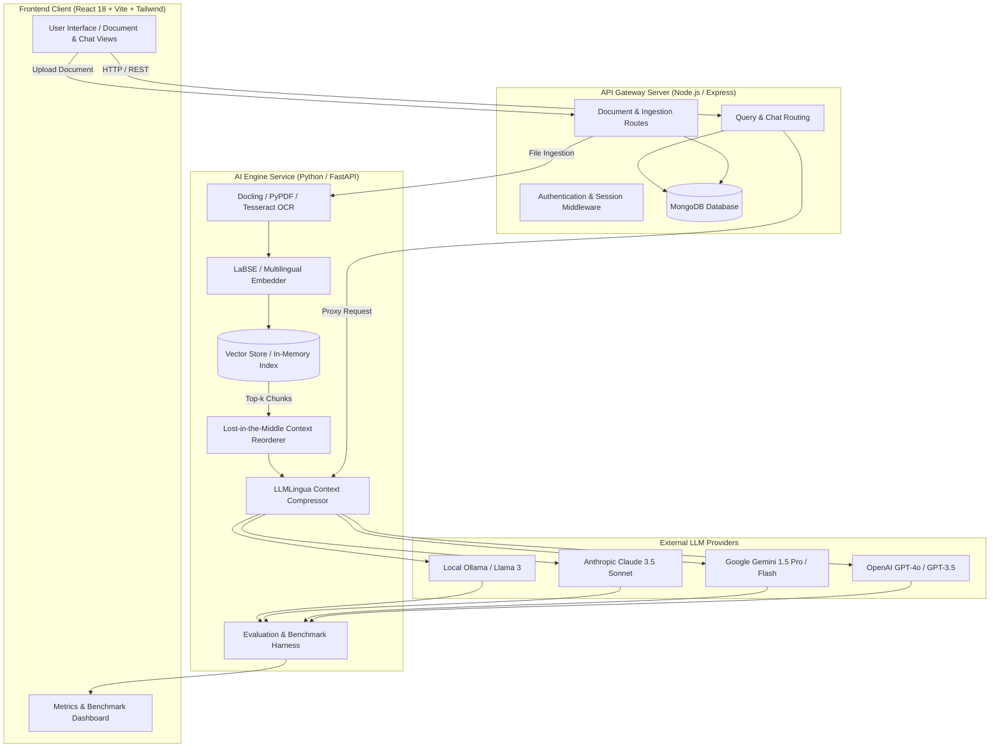

# COF-RAG: Context Optimization Framework for Document-Based RAG Systems

[](https://opensource.org/licenses/MIT)
[](https://www.python.org/)
[](https://nodejs.org/)
[](https://fastapi.tiangolo.com/)
[](https://react.dev/)
[](https://www.mongodb.com/)

**Final Year Project (BS Computer Science / Software Engineering)**  
COF-RAG is an enterprise-grade Context Optimization Framework designed to dramatically improve Retrieval-Augmented Generation (RAG) pipelines over multi-format, multilingual documents. It mitigates the critical "Lost in the Middle" phenomenon, reduces LLM inference costs and latency via intelligent prompt compression (LLMLingua), handles non-searchable scanned PDFs via OCR, and provides verifiable multi-LLM comparative benchmarking.

---

## 📑 Table of Contents
- [Key Features](#-key-features)
- [System Architecture](#-system-architecture)
- [Technology Stack](#-technology-stack)
- [Project Directory Structure](#-project-directory-structure)
- [Environment Variables](#-environment-variables)
- [Local Setup & Installation](#-local-setup--installation)
  - [Prerequisites](#prerequisites)
  - [1. AI Engine Setup (FastAPI / Python)](#1-ai-engine-setup-fastapi--python)
  - [2. Backend API Setup (Express / Node.js)](#2-backend-api-setup-express--nodejs)
  - [3. Frontend Client Setup (React / Vite)](#3-frontend-client-setup-react--vite)
- [Running in Development Mode](#-running-in-development-mode)
- [Running with Docker Compose](#-running-with-docker-compose)
- [API Endpoints Summary](#-api-endpoints-summary)
- [Benchmarking & Evaluation](#-benchmarking--evaluation)
- [License](#-license)

---

## 🚀 Key Features

1. **Context Compression & Budget Allocation**:
   - Integrated with **LLMLingua** to compress retrieved context by 2x to 5x with minimal semantic loss.
   - Reduces token expenditure (measured in both USD and PKR) and latency across all major LLM providers.
2. **Mitigation of "Lost in the Middle"**:
   - Reorders chunks dynamically so high-relevance passages reside at the attention boundaries (start and end) of prompt context.
3. **Multilingual Embeddings & Retrieval**:
   - Utilizes multilingual dense embedding models (e.g., LaBSE / SentenceTransformers) with vector search capabilities.
4. **Comprehensive Document Parsing & OCR**:
   - Automated text extraction for standard digital documents (.pdf, .docx, .txt).
   - Tesseract OCR engine fallback for scanned images and non-text PDFs.
5. **Multi-LLM Orchestration**:
   - Switchable and benchmark-compatible across OpenAI GPT-4o / GPT-3.5, Google Gemini, Anthropic Claude, and local Ollama instances.
6. **Built-in Benchmark & Evaluation Suite**:
   - Automated metrics computation: Token Compression Ratio, F1-Score / Answer Quality, Latency (ms), Cost in USD and PKR.

---

## 🏛 System Architecture

The following diagram illustrates the end-to-end data flow from client query to multi-LLM response:



---

## 🛠 Technology Stack

| Layer | Technologies |
|---|---|
| **Frontend Client** | React 18, Vite, TypeScript/JavaScript, Tailwind CSS, Lucide Icons, Axios, Chart.js / Recharts |
| **Backend API Gateway**| Node.js 18+, Express.js, Mongoose, Multer, JWT, Morgan, Cors |
| **AI Engine Service** | Python 3.10+, FastAPI, Uvicorn, LLMLingua, PyTorch, HuggingFace Transformers, SentenceTransformers (LaBSE), Tesseract OCR, PyPDF / pdfplumber |
| **Databases** | MongoDB 7.0 (Metadata, Logs, Benchmarks, Document Catalogs), ChromaDB / FAISS (Vector Store) |
| **DevOps & Containers**| Docker, Docker Compose |

---

## 📁 Project Directory Structure

```text
cof-rag/
├── apps/
│   ├── ai_engine/               # FastAPI AI & Optimization Service
│   │   ├── app/
│   │   │   ├── api/             # FastAPI Routers (v1)
│   │   │   ├── core/            # Config, logger, settings
│   │   │   ├── pipelines/       # RAG, compression, reordering pipelines
│   │   │   ├── services/        # LLM providers, OCR, embeddings
│   │   │   └── main.py          # FastAPI application entrypoint
│   │   ├── requirements.txt     # Python dependencies
│   │   └── Dockerfile
│   ├── client/                  # React / Vite Single Page Application
│   │   ├── src/                 # Components, pages, hooks, services
│   │   ├── package.json
│   │   └── Dockerfile
│   └── server/                  # Node.js Express API Gateway
│       ├── src/
│       │   ├── controllers/     # Route controllers
│       │   ├── models/          # Mongoose data schemas
│       │   ├── routes/          # Express API routes
│       │   └── server.js        # Server entrypoint
│       ├── package.json
│       └── Dockerfile
├── data/
│   ├── benchmark/               # Benchmark test dataset and results
│   │   ├── questions.json       # Standardized evaluation questions
│   │   └── results.csv          # Evaluation output records
│   └── raw/                     # Uploaded source documents (.pdf, .docx)
├── docs/
│   └── final_report/            # Academic dissertation chapters (LaTeX/Markdown)
│       ├── 01_introduction.md
│       ├── 02_literature_review.md
│       ├── 03_system_design.md
│       ├── 04_implementation.md
│       ├── 05_results.md
│       └── 06_conclusion.md
├── notebooks/                   # Jupyter exploratory research & ablation tests
├── docker-compose.yml           # Multi-service container orchestration
├── README.md                    # Project documentation
└── .gitignore                   # Version control ignore definitions
```

---

## 🔑 Environment Variables

Each application component requires its own `.env` configuration. Sample templates are provided below:

### 1. AI Engine (`apps/ai_engine/.env`)
```env
PORT=8000
HOST=0.0.0.0
DEBUG=True

# LLM API Keys
OPENAI_API_KEY=your_openai_api_key_here
GEMINI_API_KEY=your_gemini_api_key_here
ANTHROPIC_API_KEY=your_anthropic_api_key_here

# Embedding & Compression Models
EMBEDDING_MODEL=sentence-transformers/LaBSE
COMPRESSION_MODEL=microsoft/llmlingua-2-xlm-roberta-large-meeting

# Storage
UPLOAD_DIR=./data/uploads
VECTOR_DB_DIR=./data/vectordb
```

### 2. Backend Server (`apps/server/.env`)
```env
PORT=5000
NODE_ENV=development
MONGO_URI=mongodb://localhost:27017/cof_rag
AI_ENGINE_URL=http://localhost:8000
JWT_SECRET=super_secret_cof_rag_jwt_key_12345
UPLOAD_PATH=./uploads
PKR_EXCHANGE_RATE=278.50
```

### 3. Frontend Client (`apps/client/.env`)
```env
VITE_API_URL=http://localhost:5000/api
VITE_AI_ENGINE_DIRECT_URL=http://localhost:8000
```

---

## 💻 Local Setup & Installation

### Prerequisites
- Node.js (v18 or higher) & npm
- Python (v3.10 or v3.11 recommended) & pip
- MongoDB (running locally on port 27017 or via Docker)
- Tesseract OCR (installed and available in system PATH if using OCR features)

### 1. AI Engine Setup (FastAPI / Python)
```bash
# Navigate to AI Engine folder
cd apps/ai_engine

# Create virtual environment
python -m venv venv

# Activate virtual environment (Windows PowerShell)
.\venv\Scripts\Activate.ps1
# Or on Linux/macOS:
# source venv/bin/activate

# Install dependencies
pip install --upgrade pip
pip install -r requirements.txt

# Copy environment variables
cp .env.example .env
```

### 2. Backend API Setup (Express / Node.js)
```bash
# Navigate to Server folder
cd apps/server

# Install dependencies
npm install

# Copy environment variables
cp .env.example .env
```

### 3. Frontend Client Setup (React / Vite)
```bash
# Navigate to Client folder
cd apps/client

# Install dependencies
npm install

# Copy environment variables
cp .env.example .env
```

---

## 🏃 Running in Development Mode

Run each service in separate terminal sessions:

1. **Start MongoDB**:
   ```bash
   mongod --dbpath <path-to-your-db-data>
   ```

2. **Start AI Engine (FastAPI)**:
   ```bash
   cd apps/ai_engine
   .\venv\Scripts\Activate.ps1
   uvicorn app.main:app --host 0.0.0.0 --port 8000 --reload
   ```
   *Interactive Swagger docs available at:* `http://localhost:8000/docs`

3. **Start Backend Server (Node.js Express)**:
   ```bash
   cd apps/server
   npm run dev
   ```
   *Express server runs at:* `http://localhost:5000`

4. **Start Frontend (Vite / React)**:
   ```bash
   cd apps/client
   npm run dev
   ```
   *Frontend application runs at:* `http://localhost:5173`

---

## 🐳 Running with Docker Compose

To launch the complete multi-service stack with a single command:

```bash
docker-compose up --build
```

Services will be accessible at:
- **Client (Web App)**: `http://localhost:5173`
- **Server (REST API)**: `http://localhost:5000`
- **AI Engine (Swagger Docs)**: `http://localhost:8000/docs`
- **MongoDB**: `localhost:27017`

---

## 📡 API Endpoints Summary

### AI Engine (FastAPI - Port 8000)
- `POST /api/v1/documents/process` - Parse document (.pdf, .docx, scanned OCR) & build embeddings
- `POST /api/v1/context/compress` - Compress retrieved context using LLMLingua
- `POST /api/v1/context/reorder` - Reorder chunks to solve "Lost in the Middle"
- `POST /api/v1/query` - Execute end-to-end optimized RAG query
- `POST /api/v1/benchmark/run` - Run comparative evaluation matrix across configured LLMs
- `GET  /api/v1/health` - Health status and loaded model information

### Backend Server (Express - Port 5000)
- `POST /api/auth/register` & `POST /api/auth/login` - User authentication & JWT issuance
- `POST /api/documents/upload` - Secure file upload and proxy to AI engine
- `GET  /api/documents` - List indexed documents
- `POST /api/chat/message` - Send query and retrieve optimized answer with token metrics
- `GET  /api/benchmark/results` - Fetch benchmark comparison history and cost breakdowns

---

## 📊 Benchmarking & Evaluation

The benchmark dataset is located at [data/benchmark/questions.json](file:///C:/Users/MM%20COMPUTERS/.gemini/antigravity/scratch/cof-rag/data/benchmark/questions.json). Results are saved to [data/benchmark/results.csv](file:///C:/Users/MM%20COMPUTERS/.gemini/antigravity/scratch/cof-rag/data/benchmark/results.csv).

Key evaluated metrics:
- **Token Compression Ratio**: `(Original Tokens - Compressed Tokens) / Original Tokens`
- **F1 Score**: Harmonic mean of token precision and recall against ground-truth answers
- **Latency / Response Time**: Milliseconds per end-to-end request
- **Cost Reduction**: Monetary savings in USD and PKR calculated against provider pricing tiers

---

## 📄 License

This project is licensed under the MIT License - see the LICENSE file for details.
